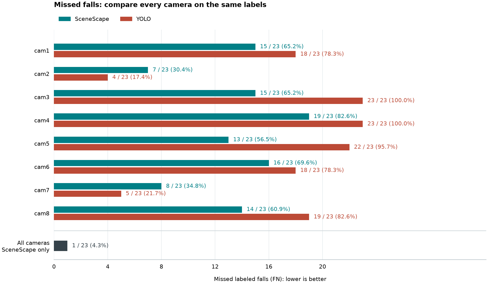
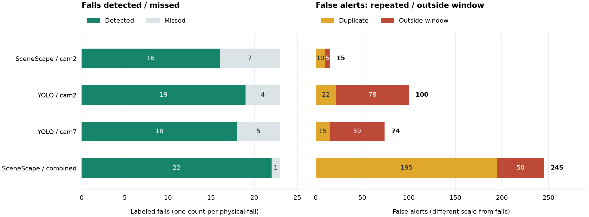
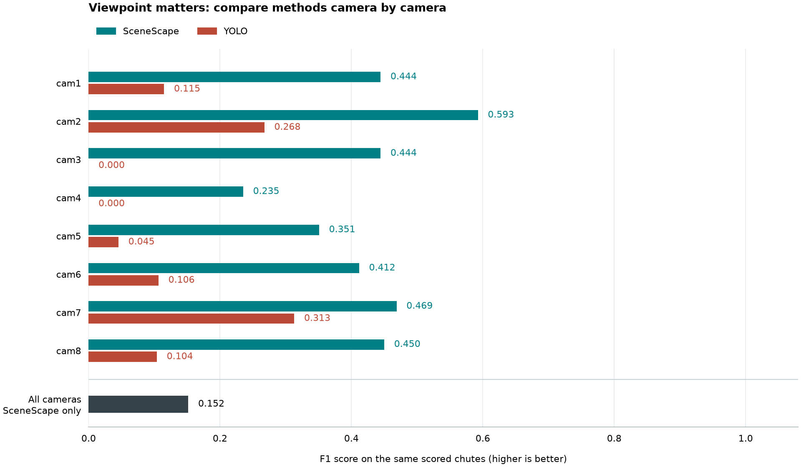

# Full Multiview Fall Detection Performance

## Main Takeaway

**When missed falls (FN) are the primary metric, combined-camera SceneScape
has the strongest observed result: 1 missed fall out of 23 (4.3%), compared
with 7 for its best single-camera view and 4 for YOLO's best single-camera
view.** The combined result also produces 245 false alerts, so this is a
recall improvement with a substantial alert-burden tradeoff.

All headline comparisons use the same **20 shared chutes and 23 labeled
physical falls**. Each physical fall is counted once per condition, not
once for every camera. Camera selections described as best are retrospective
selections from this run, not independently validated choices.

This report documents run `results-full-multiview-20261105T150236Z`, completed
on November 9, 2026 at 20:59:22 UTC with status `complete_with_failures`.
It is separate from the [earlier single-camera experiment](performance.md).

## Missed Falls: Primary Metric

Lower FN is better. Labels on the chart show missed falls / labeled falls
and the percentage missed. With a fixed labeled-fall count, the missed
percentage is one minus recall. Combined cameras are shown separately;
their result is not an average of the individual-camera scores.

| Camera | SceneScape FN / 23 | Missed | YOLO FN / 23 | Missed |
| --- | ---: | ---: | ---: | ---: |
| cam1 | 15 | 65.2% | 18 | 78.3% |
| cam2 | 7 | 30.4% | 4 | 17.4% |
| cam3 | 15 | 65.2% | 23 | 100.0% |
| cam4 | 19 | 82.6% | 23 | 100.0% |
| cam5 | 13 | 56.5% | 22 | 95.7% |
| cam6 | 16 | 69.6% | 18 | 78.3% |
| cam7 | 8 | 34.8% | 5 | 21.7% |
| cam8 | 14 | 60.9% | 19 | 82.6% |
| Combined | **1** | **4.3%** | Not evaluated | Not evaluated |

Combined SceneScape misses six fewer labeled falls than SceneScape cam2,
its lowest-FN single view, and three fewer than YOLO cam2, YOLO's lowest-FN
view. SceneScape has fewer misses than YOLO in six of eight matched views;
YOLO has fewer in cam2 and cam7. Thus, higher SceneScape F1 in every matched
view does **not** mean fewer misses in every view.

## Alert-Burden Tradeoff

| Condition | Detected (TP) | Missed (FN) | Recall | False Alerts (FP) | Precision | F1 |
| --- | ---: | ---: | ---: | ---: | ---: | ---: |
| SceneScape, combined | 22 | **1** | **95.7%** | 245 | 8.2% | 0.152 |
| SceneScape, cam2 | 16 | 7 | 69.6% | 15 | 51.6% | **0.593** |
| YOLO, cam2 | 19 | 4 | 82.6% | 100 | 16.0% | 0.268 |

The single-camera rows above are selected by lowest FN for each method,
not by YOLO's best F1. YOLO's highest observed F1 is instead cam7 at 0.313,
with 18 TP, 5 FN, and 74 FP.

The plot includes the lowest-FN single views, YOLO's highest-F1 view, and
combined SceneScape. Its two panels use different scales: labeled physical
falls on the left and false alerts on the right.

Of the combined condition's 245 false alerts, **195 (79.6%) are duplicates**
within already-matched fall windows, and 50 are outside matching windows.
Only 8.2% of its emitted alerts count as true positives under this scoring
rule. Duplicate alerts are not additional physical falls and are not
discarded from the reported scores.

Repeated alerts are an investigation priority, but these counts do not
establish their root cause or the recall/precision benefit of a proposed
deduplication change. Reducing alert burden must be evaluated without
sacrificing the primary missed-fall metric.

## Secondary F1 Comparison

SceneScape has higher F1 than YOLO in all eight matched single-camera views.
Its highest single-camera F1 is cam2 at 0.593, versus YOLO cam7 at 0.313.
Combined SceneScape has F1 0.152: it catches more labeled falls, but its
false-alert count lowers precision and F1. F1 supplies secondary context
here; it does not replace FN as the primary metric and is not accuracy or
processing speed.

## Evaluation Setup

- **Scope:** 24 requested chutes, each with eight camera videos. SceneScape
  evaluates eight independent single-camera conditions and one combined
  condition per chute. YOLO evaluates each camera independently; no combined
  YOLO condition is evaluated.
- **Joint mapping:** MapAnything reconstructs the camera views together.
  The full run uses YOLO11x-pose for mapping-frame selection at its plugin
  default confidence of 0.5. Calibration, floor alignment, and scale remain
  estimates, not measured ground truth.
- **SceneScape input:** YOLO11s-pose person detections at plugin defaults
  supply bounding boxes to SceneScape tracking and geometry/motion-based
  fall detection. Pose keypoints are not forwarded as fall evidence.
- **YOLO fall baseline:** the supplied `best.pt` runs directly on source
  frames on CPU, with confidence 0.4 and rearming after 0.25 source seconds
  without a fall detection. This baseline does not use person tracking.
- **Timing:** SceneScape replay uses speed 0.25, a fourfold slowdown, with
  a 120-second registration settle period and a three-second drain period.
  Labels and alerts are scored in source-video seconds, not replay seconds.
  No inference-speed or real-world response-time claim is made here.
- **Scoring:** matching allows +/-1 source second around each reviewed fall
  interval. Each interval receives at most one TP; unmatched intervals are
  FN. Additional alerts, including duplicates, are FP. Counts are summed
  within a condition, never pooled across camera conditions.

## Coverage And Limitations

All scheduled stages for all 24 chutes were attempted. Three SceneScape
conditions failed with no observed scene people and remain unscored:

| Chute | Failed Condition |
| --- | --- |
| chute07 | cam4 |
| chute13 | cam6 |
| chute18 | cam2 |

These are pipeline failures, **not ordinary false negatives or successful
zero-miss runs**. Their cause is not established by the aggregate scores.

Separately, chute06/cam1 has a video duration of approximately 10.466667
seconds while its final labeled interval ends at 11 seconds. The 0.533333
second shortfall exceeds the evaluator's strictly-below-0.5-second allowance.
SceneScape cam1, YOLO cam1, and the dependent SceneScape combined condition
are therefore unscored for chute06.

The common comparison excludes all four affected chutes (06, 07, 13, 18)
from **every** condition, leaving 20 chutes and 23 labeled falls. Individual
conditions have different available coverage and may include more chutes;
their individual scores must not be substituted into these headline comparisons.

The sample is small, and retrospective viewpoint selection can overstate
generalization. The experiment compares configured end-to-end pipelines,
not isolated classifiers. SceneScape emits person-level transitions while
the YOLO baseline groups alerts at clip level; the scoring does not establish
identity-specific performance on simultaneous falls. False-alert counts
are not false alerts per hour, and neither the FN result nor the F1 result
establishes deployment readiness.

## Evidence And Next Steps

The [saved summary CSV](reports/multiview/summary.csv) preserves both
`common` and `individual` rows from the completed run. All tables and charts
in this report use the `common` rows. The CSV records each row's chute list,
coverage, counts, and metrics; the PNGs are snapshots generated from those
saved scores without inference or rescoring. Full raw messages, calibration
assets, failure audits, and videos remain in the local run directory, not
in this documentation snapshot.

1. Ensure that camera are in sync
2. Retry the three failed conditions separately, preserving their original
   failure evidence; recompute shared coverage if those retries succeed.
3. Investigate duplicate alerts and outside-window triggers, testing proposed
   changes against FN first rather than assuming repeats can be removed safely.
